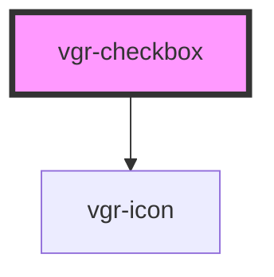

# vgr-checkbox

<!-- Auto Generated Below -->

## Properties

| Property               | Attribute                 | Description | Type      | Default     |
| ---------------------- | ------------------------- | ----------- | --------- | ----------- |
| `checked`              | `checked`                 |             | `boolean` | `false`     |
| `collapsibleChildren`  | `collapsible-children`    |             | `boolean` | `false`     |
| `disabled`             | `disabled`                |             | `boolean` | `false`     |
| `indeterminate`        | `indeterminate`           |             | `boolean` | `false`     |
| `label` _(required)_   | `label`                   |             | `string`  | `undefined` |
| `name`                 | `name`                    |             | `string`  | `undefined` |
| `srOnlyDisabledReason` | `sr-only-disabled-reason` |             | `string`  | `undefined` |
| `value`                | `value`                   |             | `string`  | `undefined` |

## Events

| Event       | Description | Type                                                 |
| ----------- | ----------- | ---------------------------------------------------- |
| `vgrChange` |             | `CustomEvent<{ value?: string; checked: boolean; }>` |

## Slots

| Slot | Description      |
| ---- | ---------------- |
|      | The default slot |

## Dependencies

### Depends on

- [vgr-icon](../vgr-icon)

### Graph

----------------------------------------------

*Built with [StencilJS](https://stenciljs.com/)*
