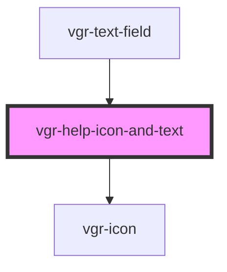

# vgr-help-icon-and-text

<!-- Auto Generated Below -->

## Properties

| Property       | Attribute        | Description | Type             | Default     |
| -------------- | ---------------- | ----------- | ---------------- | ----------- |
| `info`         | --               |             | `VgrInfoContent` | `undefined` |
| `vgrAriaLabel` | `vgr-aria-label` |             | `string`         | `undefined` |

## Dependencies

### Used by

 - [vgr-text-field](../vgr-text-field)

### Depends on

- [vgr-icon](../vgr-icon)

### Graph

----------------------------------------------

*Built with [StencilJS](https://stenciljs.com/)*
