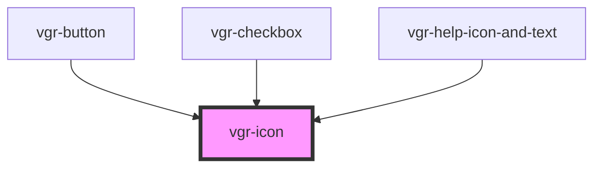

# vgr-icon

<!-- Auto Generated Below -->

## Properties

| Property            | Attribute | Description                                                                                                                                                            | Type                                | Default     |
| ------------------- | --------- | ---------------------------------------------------------------------------------------------------------------------------------------------------------------------- | ----------------------------------- | ----------- |
| `icon` _(required)_ | `icon`    | SVG markup for the icon. Must come from one of our own icon sources, never from user input, since it is rendered with innerHTML.                                       | `string`                            | `undefined` |
| `size`              | `size`    | Height in Tailwind's spacing scale (4 = 16px, 6 = 24px). The width follows the icon's own proportions. Defaults to 1em, so the icon follows the surrounding font-size. | `"2.5" \| "3" \| "4" \| "5" \| "6"` | `undefined` |

## Dependencies

### Used by

 - [vgr-button](../vgr-button)
 - [vgr-checkbox](../vgr-checkbox)
 - [vgr-help-icon-and-text](../vgr-help-icon-and-text)

### Graph

----------------------------------------------

*Built with [StencilJS](https://stenciljs.com/)*
