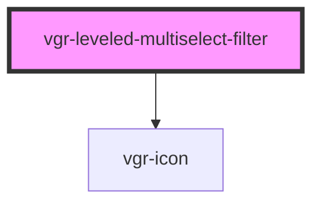

# vgr-leveled-multiselect-filter

<!-- Auto Generated Below -->

## Properties

| Property         | Attribute         | Description | Type     | Default |
| ---------------- | ----------------- | ----------- | -------- | ------- |
| `initialVisible` | `initial-visible` |             | `number` | `10`    |

## Slots

| Slot | Description      |
| ---- | ---------------- |
|      | The default slot |

## Dependencies

### Depends on

- [vgr-icon](../vgr-icon)

### Graph

----------------------------------------------

*Built with [StencilJS](https://stenciljs.com/)*
