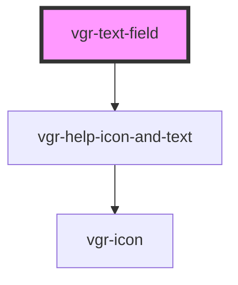

# vgr-text-field

<!-- Auto Generated Below -->

## Properties

| Property               | Attribute                 | Description                               | Type                                                                          | Default     |
| ---------------------- | ------------------------- | ----------------------------------------- | ----------------------------------------------------------------------------- | ----------- |
| `autoComplete`         | `auto-complete`           |                                           | `boolean`                                                                     | `false`     |
| `disabled`             | `disabled`                |                                           | `boolean`                                                                     | `false`     |
| `error`                | `error`                   |                                           | `string`                                                                      | `undefined` |
| `helpText`             | `help-text`               |                                           | `string`                                                                      | `undefined` |
| `info`                 | --                        |                                           | `VgrInfoContent`                                                              | `undefined` |
| `label`                | `label`                   |                                           | `string`                                                                      | `undefined` |
| `optional`             | `optional`                |                                           | `boolean`                                                                     | `false`     |
| `placeholder`          | `placeholder`             |                                           | `string`                                                                      | `undefined` |
| `required`             | `required`                |                                           | `boolean`                                                                     | `false`     |
| `rows`                 | `rows`                    | `rows` is only applied for type: textarea | `number`                                                                      | `undefined` |
| `srOnlyDisabledReason` | `sr-only-disabled-reason` |                                           | `string`                                                                      | `undefined` |
| `type`                 | `type`                    |                                           | `"email" \| "number" \| "password" \| "tel" \| "text" \| "textarea" \| "url"` | `'text'`    |
| `value`                | `value`                   |                                           | `number \| string`                                                            | `undefined` |

## Dependencies

### Depends on

- [vgr-help-icon-and-text](../vgr-help-icon-and-text)

### Graph

----------------------------------------------

*Built with [StencilJS](https://stenciljs.com/)*
